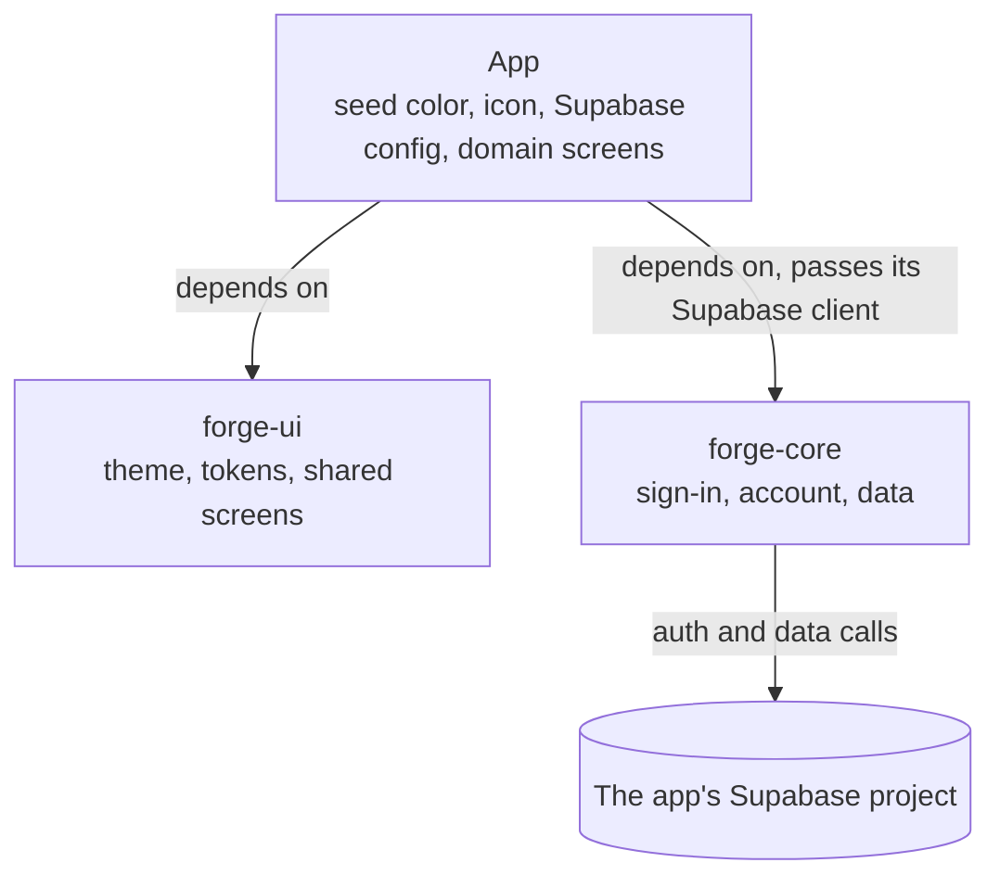

# forge-ui & forge-core: Shared Flutter Packages Spec

Oct 8, 2026 · @Tim Klimpel · Status: Approved, ready to start · Revised Oct 10, 2026 (spec pass, forge-ui v0.1 build, release method)

## Purpose and goals

All tkforgeworks client apps move to Flutter, so two shared packages carry the parts every app repeats: `forge-ui` for the brand look, `forge-core` for sign-in, account and data plumbing. Each app supplies only its colors, icon, Supabase config and domain screens.

Goals:

- **One brand, many apps.** Typography, shapes, spacing and shared screens are identical across apps; each app changes its seed color and icon.
- **Write auth and account deletion once.** Google + Apple sign-in, identity linking and deletion live in `forge-core`, not in each app.
- **Store-ready by default.** Any app built on the packages starts compliant with Apple guideline 4.8, in-app account deletion on both stores, and a short, honest privacy disclosure.
- **Stay in free tiers during development.** Supabase free plan for dev; paid only once an app has real users.

Non-goals for v1: analytics, crash reporting, push notifications, file/photo storage helpers, a local-first sync helper, and a lint/CLAUDE.md org standard.

## Scope and package boundaries

Apps depend on both packages; the two packages never depend on each other. Shared screens in `forge-ui` (sign-in, account settings) take callbacks, and each app wires those callbacks to `forge-core`. This keeps `forge-ui` free of Supabase and `forge-core` free of styling.

| Layer | Owns | Examples | Never contains |
| --- | --- | --- | --- |
| `forge-ui` | Brand look and generic screens | Theme builder, tokens, buttons, cards, form fields, empty/error/loading states, dialogs, settings + about scaffolds | Supabase calls, app-specific widgets, hardcoded colors |
| `forge-core` | Account and data plumbing | Sign-in (Google, Apple), identity linking, account deletion, session state, jsonb repository helper | Supabase URL/keys, app schemas, UI styling |
| Each app | Its identity and domain | Seed color, icon, Supabase config, tables, domain screens (e.g. cheese tasting forms) | Copies of shared widgets or auth code |

**Rule of three for promotion.** Code moves into a package only when a second app needs it, ideally after a third confirms its shape. Until then it lives in the app that uses it.



There is no arrow between the two packages. Only `forge-core` talks to Supabase, and only the app knows which Supabase project it talks to.

## forge-ui design

`forge-ui` exports one theme builder: an app passes its seed color (and optional accent), and everything else about the brand is fixed inside the package.

```dart
ThemeData forgeTheme({
  required Color seed,
  Color? accent,
  Brightness brightness = Brightness.light,
  ColorScheme? colorScheme,
  ForgeTokens? tokens,
  Iterable<ThemeExtension> extensions = const [],
}) {
  final scheme = colorScheme ?? forgeColorScheme(seed: seed, brightness: brightness);
  final forge = tokens ?? ForgeTokens.standard(scheme, accent: accent);
  return ThemeData(
    colorScheme: scheme,
    textTheme: ForgeType.textTheme(scheme, forge),
    // ...every component theme: buttons, cards, inputs, chips, sheets, drawer
    extensions: [forge, ...extensions],
  );
}
```

- **A seed is enough.** `forgeColorScheme` is Material's seeded scheme with quieter outline colors, because the brand draws its borders and dividers as soft lines.
- **An app with a designed palette passes its own `colorScheme` and `tokens`**, one pair per brightness. The brand's type, shapes and component themes apply on top unchanged. The cheese app does this to keep its cream and rind-amber palette.
- **`ForgeTokens`** holds the color roles `ColorScheme` has no slot for (tertiary and ghost text, link, row divider, success pair, error tint, skeleton shimmer, accent). An app's own roles go in its own extension, passed through `extensions`.

| Fixed in forge-ui (the brand) | Set per app |
| --- | --- |
| Typography and type scale | Seed color, optional accent; or a designed color scheme and tokens |
| Corner radii, spacing scale, elevation | App icon and name |
| Button, card, input and dialog shapes |  |
| Motion durations and curves |  |
| Icon style (Heroicons, outline) |  |
| "Made by tkforgeworks" about screen |  |

**Hard rule: shared widgets never hardcode a color.** Every color comes from `Theme.of(context).colorScheme` or the `ForgeTokens` theme extension. One hardcoded color breaks theme swapping for every app. The one exception is the brand itself: the forge gradient and the colors of the hammer-and-anvil mark are named constants in `ForgeBrand`, identical in every app. A test in the package fails on any other color literal.

**Fonts are fixed and bundled in forge-ui.** Apps don't override them. The three families are the ones the cheese app and the website already use:

| Family | Role | Weights bundled |
| --- | --- | --- |
| Poppins | UI: titles, body, buttons, form fields | 400, 500, 600, 700 |
| Source Serif 4 | Editorial: long-form text, names, taglines | 400 and 600, each with italic |
| JetBrains Mono | Labels, tags and codes | 400, 500 |

- The .ttf/.otf files live in `forge-ui/assets/fonts/` and are declared under `fonts:` in forge-ui's `pubspec.yaml`. Apps get them through the dependency, with no copying.
- Static instances, not variable fonts, so `FontWeight` selects the face directly. The weights above are the starting set (the ones the cheese app ships); a new weight is added to the package before any widget uses it.
- No runtime font download through `google_fonts`. A download is an undisclosed network call to Google and fails offline.
- Only SIL Open Font License (OFL) fonts. Each family's OFL text ships beside the files, is listed in `NOTICE`, and is registered with `LicenseRegistry` so it shows on each app's licenses page.
- No commercial fonts unless their license explicitly covers app embedding. Modified OFL fonts get a new name.

**Icons are Heroicons, outline style.** `forge_ui` depends on the `heroicons` package (MIT) and its shared widgets use the outline style. Apps use the same package and style on their own screens.

v1 widget set, by release:

| Release | Ships | Alongside |
| --- | --- | --- |
| forge-ui v0.1 | Theme builder, tokens and component themes (buttons, cards, inputs, chips, segmented toggle, switch, slider, drawer, sheets); mono label, tag and status capsules, boxed field, confirm sheet (including the destructive delete confirmation), empty, error and loading states, settings group, the gradient FAB, the TK ForgeWorks mark; about screen with privacy policy and deletion links, and the licences summary screen | — |
| forge-ui v0.2 | Sign-in screen with Google and Apple buttons (callbacks in, no auth logic) | forge-core v0.1 |
| forge-ui v0.3 | Account settings page: linked sign-in methods, sign out, delete account | forge-core v0.2 |

The v0.1 contents are the generic pieces of the cheese app, promoted as they stand. Its journal field, star rating, flavor wheel and other domain widgets stay in the app.

The two screens that front `forge-core` ship with the `forge-core` release they pair with, so their callbacks are shaped against the real API rather than a guess.

**Sign-in screen.** `onGoogle` and `onApple` are nullable callbacks. A null callback means that button is not rendered, which is how an Android app leaves out Apple until it is supported there. A debug assert requires at least one. On iOS an app passes both (Apple guideline 4.8).

**Account settings page.** `forge-ui` cannot import `forge-core`, so it defines its own plain types for linked sign-in methods, and the app maps `forge-core`'s identities onto them. `forge-ui` owns each provider's label and logo, so every app shows them the same way.

```dart
enum ForgeSignInProvider { google, apple }

@immutable
class ForgeLinkedSignIn {
  const ForgeLinkedSignIn({required this.provider, this.email});
  final ForgeSignInProvider provider;
  final String? email; // may be an Apple relay address
}

ForgeAccountSettings(
  linked: [ForgeLinkedSignIn(provider: ForgeSignInProvider.google, email: email)],
  onLink: (provider) {...}, // null hides "Link another sign-in method"
  onSignOut: () {...},
  onDeleteAccount: () {...},
)
```

Material 3 is the base. If iOS later needs a more native feel, the platform adjustments go inside `forge-ui`, not in each app.

## forge-core design

`forge-core` wraps Supabase Auth and a small jsonb data layer. Every app offers the same two sign-in buttons on every platform, and one Apple or Google identity always reaches the same account.

### Sign-in flows

| Platform | Google | Apple |
| --- | --- | --- |
| iOS | Native `google_sign_in` → `signInWithIdToken` | Native `sign_in_with_apple` → `signInWithIdToken` |
| Android | Native `google_sign_in` → `signInWithIdToken` | Later: browser tab via `signInWithOAuth(OAuthProvider.apple)` |
| Web (future) | `signInWithOAuth(OAuthProvider.google)` | `signInWithOAuth(OAuthProvider.apple)` |

Apple setup, once per app:

- **Now (iOS native only):** an App ID with Sign in with Apple enabled, and the iOS bundle ID in the Supabase Apple provider's Client IDs.
- **Now, for deletion:** a signing key (.p8) in the Edge Function secrets. On a user's first Apple sign-in, an Edge Function exchanges the authorization code for an Apple refresh token and stores it in Supabase Vault, so the purge can revoke it later.
- **Later, with Android and web:** a Services ID linked to the same App ID (same developer team) with Supabase's callback URL registered, an OAuth client secret generated from the .p8, and the Services ID listed **first** in Client IDs.

Behaviors the package must handle:

- **Name:** Apple returns it only on the first native sign-in and never through the OAuth flow. Save it to `accounts.display_name` when present; otherwise the app asks for an optional display name.
- **Same account across platforms:** Apple's user identifier is stable per developer team across native and web flows, including Hide My Email relay addresses. No extra work beyond the shared team setup.
- **Cross-provider linking:** Apple (hidden email) and Google never match by email. Account settings expose "Link another sign-in method" using Supabase `linkIdentity`.

### Account deletion

One `deleteAccount()` call does all of it:

1. Call the `request_account_deletion()` database function, which sets `accounts.deletion_requested_at` for the caller, then sign out every session. From that moment row-level security refuses the account's rows (see the data model), even for an access token that has not expired yet.
2. A purge Edge Function (service role key) revokes the Apple token and deletes its Vault secret, deletes the user's Storage files, then deletes the Supabase auth user.
3. The `accounts` row and all `entries` rows go with it through `on delete cascade`.
4. The app clears local storage on the device.

**What drives the purge.** Setting the flag starts a first purge attempt straight away. A scheduled job in the database (`pg_cron` calling the function through `pg_net`, every 15 minutes) re-runs the purge for every account whose `deletion_requested_at` is still set, so a failed attempt is retried until it succeeds. Both are set up by `forge-core`'s migration.

No anonymized copies are kept. Entries are private and their free text can itself hold personal details, so deletion removes them. If usage stats are ever wanted, keep an aggregate counter with no content and no user link. The privacy policy states the purge window.

**Web deletion requests.** Each app has its own page at `tkforgeworks.com/policy/<app>/delete-account` (the Google Play deletion URL), linked from that app's privacy policy at `policy/<app>`. The page names the app as it appears on the store listing, lists what gets deleted and the purge window, and hosts a request form that feeds the same purge pipeline:

1. The form takes the account email, protected by a bot check and rate limiting.
2. A request Edge Function emails a single-use confirmation link (Resend) if that email matches an account. The response is identical either way, so the form can't be used to discover accounts. The token is stored only as a hash, with an expiry, in a table in a private schema that the API does not expose (service role only).
3. Clicking the link calls a confirm Edge Function, which sets `accounts.deletion_requested_at`, and the standard purge runs from there.

The page and its form live in the website repo (`TKForgeWorks_website`, a static export), one per app. `forge-core` ships only the two Edge Functions behind it, request and confirm, and the form posts to that app's Supabase project.

Apple sign-in users may only know their relay address, so the page explains that, and the sending domain is registered with Apple's private email relay so confirmation emails get through.

The purge, request and confirm Edge Functions and the `accounts` migration live in `forge-core` under `supabase/`. A sync script in `forge-core` copies them into an app's `supabase/` folder at the app's pinned tag, and the app deploys them with the Supabase CLI. App CI fails if the copies drift from the pinned version, so no app can quietly change the deletion policy.

### Data model

One generic table shape per app, scoped by row-level security:

```sql
create table entries (
  id uuid primary key default gen_random_uuid(),
  user_id uuid not null references auth.users on delete cascade,
  kind text not null,
  data jsonb not null,
  created_at timestamptz not null default now(),
  updated_at timestamptz not null default now()
);
alter table entries enable row level security;
create policy "own rows" on entries
  for all using (auth.uid() = user_id and forge_account_active())
  with check (auth.uid() = user_id and forge_account_active());
```

Every app also gets an `accounts` table, one row per user. The migration creates it before `entries`, because the policy above calls `forge_account_active()`:

```sql
create table accounts (
  id uuid primary key references auth.users on delete cascade,
  display_name text,
  created_at timestamptz not null default now(),
  deletion_requested_at timestamptz
);
alter table accounts enable row level security;
create policy "own row" on accounts for select using (auth.uid() = id);

-- True while the caller's account is not pending deletion.
create function forge_account_active() returns boolean
  language sql stable security definer set search_path = ''
  as $$
    select exists (
      select 1 from public.accounts
      where id = auth.uid() and deletion_requested_at is null
    );
  $$;
```

- **Rows are created by a trigger** on `auth.users`, so an account never exists without its row.
- **The client reads only its own row and never writes the table directly.** There is no insert, update or delete policy. Changes go through security-definer functions that act on `auth.uid()` only: `request_account_deletion()` sets the flag, and a second one sets `display_name`.
- `deletion_requested_at` marks an account as pending deletion so a failed purge can be retried; it never keeps a deleted account around.

Server-side state that is not user data stays out of reach of the client: the Apple refresh token is a Supabase Vault secret per user, and the web-deletion confirmation tokens sit in the private schema described above.

**Cascade rule.** Every table holding user-owned rows declares `user_id uuid not null references auth.users on delete cascade` and includes `forge_account_active()` in its policy, as `entries` does. Postgres's default (no action) would block the purge instead of deleting the rows. Vault secrets and files in Supabase Storage are not rows that cascade, so the purge function deletes them explicitly before removing the auth user.

**Storage path rule.** A user's files live under `<bucket>/<user_id>/...`. The purge walks every bucket in the project and deletes that prefix, so it needs no per-app configuration and a new bucket cannot be forgotten.

- `forge-core` ships a typed repository helper over this shape (`kind` + a `fromJson`/`toJson` pair per type).
- Fields move from `data` into real columns only when an app needs to query or index them.
- No sync helper in v1. A local-first app builds its own sync, and the helper is promoted into `forge-core` only when a second app needs it.
- Each app owns its Supabase project, migrations and table names; `forge-core` takes the client as a parameter.

## Privacy and store compliance

Apps built on the packages collect only what sign-in and the app's own data need, so every app starts from the same four-row data inventory and adds rows only for what it adds.

| Data | Purpose | Apple privacy label | Google Play Data safety |
| --- | --- | --- | --- |
| Email (may be an Apple relay address) | Account | Contact Info → Email Address | Personal info → Email address |
| Name (optional) | Display | Contact Info → Name | Personal info → Name |
| Account ID | Authentication | Identifiers → User ID | Personal info → User IDs |
| User entries | App functionality | User Content → Other User Content | App activity → Other user-generated content |

Declared for every row: linked to the user, not used for tracking, encrypted in transit, deletable on request.

Requirements every app meets before release:

- [ ] Google and Apple sign-in both offered on iOS (Apple guideline 4.8)
- [ ] In-app account deletion via `forge-core`
- [ ] Deletion page and request form at tkforgeworks.com/policy/\<app>/delete-account (Google Play)
- [ ] Privacy policy at tkforgeworks.com/policy/\<app>, naming Supabase as the data processor and its hosting region
- [ ] Data inventory kept in the app repo (for example `PRIVACY.md`) and updated before any new SDK or field ships
- [ ] No analytics or crash-reporting SDKs unless added to the inventory first
- [ ] Server functions never log the contents of `data`

`forge-core` ships a privacy policy template and the base inventory so each app only fills in its own rows.

## Repos, versioning and distribution

Each package lives in its own repo (`tkforgeworks/forge-ui`, `tkforgeworks/forge-core`) and apps consume it as a git dependency pinned to an exact release tag.

```yaml
dependencies:
  forge_ui:
    git:
      url: https://github.com/tkforgeworks/forge-ui.git
      ref: v0.1.0
```

- **Semantic version tags, pinned exactly.** An app names one tag, so changing that line is the only way it picks up brand changes. Version-range constraints on the git dependency were considered and turned down.
- **Release candidates.** `vX.Y.Z-rc.N` tags are cut from the release branch so an app can adopt and test a version before its stable tag exists.
- **Releases come from the org Flutter release pipeline** with both platform builds off. A package release is a tag and a GitHub release whose notes are the commit subjects; there are no files to attach.
- **Additive changes.** New parameters get defaults, so an app can move to a newer tag without touching its screens. Breaking changes bump the major version and come with a migration note.
- **Showcase app in the `forge-ui` repo.** It renders every component in light and dark with two or three seed colors. Run it before tagging; it also serves as reference for Claude Code when building new screens.
- **Tests.** Widget golden tests for the showcase; unit tests for `forge-core` with a mocked Supabase client.

**Visibility: public.** Both repos are public so open-source apps and outside contributors can build against them. Neither package holds secrets; keys live in each app's config.

Licensing follows the tkforgeworks org standards:

- Both packages are Apache-2.0: a `LICENSE` (the verbatim Apache text) and a `NOTICE` in each repo. `pubspec.yaml` has no license field, because Dart has none; pub reads `LICENSE`.
- Image assets are all rights reserved, as stated in `NOTICE`.
- `NOTICE` lists bundled third-party assets, starting with the fonts (SIL OFL, with each family's OFL text shipped beside the files and registered in `LicenseRegistry`).
- Third-party dependencies stay on licenses compatible with the package license; check before adding one.
- Contributions are accepted under the repo's license via the org's contributing guidelines.

## Operational concerns

The Supabase free-tier pause is the one item that can quietly break a released app today. The Apple client secret joins it once Apple sign-in reaches Android or web.

**Apple client secret.** Not needed while Apple sign-in is iOS-native only: the purge function signs a short-lived client secret from the .p8 for each revocation, so nothing expires. The Android and web OAuth flow needs a stored secret that Apple caps at about 6 months. If it lapses, Apple sign-in fails on Android and web while iOS keeps working.

- Ship a rotation job (GitHub Action or homelab CI, every 5 months) together with Android Apple sign-in.
- Keep the .p8 only in CI and Edge Function secret stores; revoke and replace it if it is ever exposed.

**Supabase free tier.** As of September 2026 the free plan allows 2 active projects per organization, and free projects pause after 7 days of inactivity.

- The cheese app already uses one of the two slots.
- Fine for development; a pause in production blocks sign-in and sync until reactivated. A paused project runs no scheduled jobs either, so pending purges wait until then.
- Local-first apps (Drift as the working store) degrade gracefully: the app works, sync waits.
- Move to Pro ($25 per organization per month, no inactivity pause) when the first app has real users. One Pro organization covers all apps.

Sources: [Supabase: Login with Apple](https://supabase.com/docs/guides/auth/social-login/auth-apple) · [Supabase pricing review, Sept 2026](https://www.jetadmin.io/blog/supabase-review/) · [Google Play: account deletion requirements](https://support.google.com/googleplay/android-developer/answer/13327111)

## Milestones

Work runs in five steps, with the cheese app as the first real consumer before any new app starts.

1. **Repo setup.** Create both repos, run the org standards check, add CI and the empty showcase app.
2. **forge-ui v0.1.** Theme builder, tokens, base components, about screen, showcase in light and dark with three seeds.
3. **forge-core v0.1.** Native Google and Apple sign-in on iOS, Google native on Android (Apple on Android comes later), session state, jsonb repository helper, and the `accounts` table with its trigger and the `forge_account_active()` policy helper (the `entries` policy depends on them). forge-ui v0.2 ships the sign-in screen alongside.
4. **Account and privacy v0.2.** Identity linking, deletion Edge Function with Apple revocation and scheduled retry, privacy policy template, base data inventory, web deletion page and request form. forge-ui v0.3 ships the account settings page alongside.
5. **Adopt.** Move the cheese app onto both packages, fix what that exposes, tag v1.0, then start the new app on v1.0. The cheese app's 0.1.0 store release ships first, on its own copies of the shared code, so a refactor of every screen does not hold it up. It adopts forge-ui in 0.1.1 (CHEESE-48), against release candidates until forge-ui v0.1.0 is final, and forge-core when it adds accounts and sync (CHEESE-11). Its photo storage stays app-side for now.

Later, outside these milestones: Apple sign-in on Android and web, shipped together with the client secret rotation job.

## Decisions

All review decisions are settled and reflected in the sections above.

| Topic | Decision | Applies in |
| --- | --- | --- |
| Repo visibility | Public, relying on open-source licenses and future contributors | Repos, versioning and distribution |
| Naming | Repos hyphenated (`forge-ui`, `forge-core`); Dart packages underscored (`forge_ui`, `forge_core`) | Repos, versioning and distribution |
| Fonts | Poppins (UI), Source Serif 4 (editorial) and JetBrains Mono (labels), fixed and bundled in `forge-ui` (OFL only); apps don't override | forge-ui design |
| Color source | A seed by default; an app with a designed palette passes its own `ColorScheme` and `ForgeTokens` | forge-ui design |
| Brand colors | The forge gradient and the mark's colors are named constants in `ForgeBrand`, the one exception to the no-hardcoded-color rule | forge-ui design |
| forge-ui v0.1 contents | The cheese app's generic widgets and its about and licences screens; domain widgets stay in the app | forge-ui design |
| Icon style | Heroicons outline, through the `heroicons` package | forge-ui design |
| Shared screen timing | About screen in forge-ui v0.1; sign-in screen in v0.2 with forge-core v0.1; account settings in v0.3 with forge-core v0.2 | forge-ui design, Milestones |
| Hiding a sign-in provider | A null callback leaves the button out | forge-ui design |
| Linked sign-in methods | `forge-ui` defines its own `ForgeSignInProvider` enum and `ForgeLinkedSignIn` type | forge-ui design |
| Signature component | Dropped; the spec sets no limit on app-specific widgets | forge-ui design |
| License | Apache-2.0 per the org standard; no license field in `pubspec.yaml` | Repos, versioning and distribution |
| Apple sign-in on Android | Deferred; iOS native first | forge-core design |
| Deletion logic | Lives in `forge-core`, synced into each app at its pinned tag | Account deletion |
| Deleted data | Fully removed; no anonymized retention | Account deletion |
| Stop serving on deletion | Every user-owned table's policy checks `forge_account_active()`, so access ends when the flag is set | Account deletion, Data model |
| `accounts` rows | Created by a trigger on `auth.users`; the client reads its own row and writes only through security-definer functions | Data model |
| Purge trigger | A first attempt when the flag is set, then a `pg_cron` retry every 15 minutes | Account deletion |
| Storage cleanup | User files live under `<bucket>/<user_id>/`; the purge walks every bucket | Data model |
| Server-side state | `display_name` on `accounts`; Apple refresh token in Supabase Vault; confirmation tokens hashed in a private schema | Account deletion, Data model |
| Sync helper | Out of v1; promoted only when a second app needs it | Scope, Data model |
| Web deletion page | Lives in the website repo; `forge-core` ships only the Edge Functions behind it | Account deletion |
| Policy pages | `tkforgeworks.com/policy/<app>` for the privacy policy; `policy/<app>/delete-account` as its own page with a request form | Account deletion, Privacy |
| Cheese app | Ships its 0.1.0 store release first; adopts forge-ui in 0.1.1 and forge-core when it adds accounts and sync | Milestones |
| Consuming a release | An exact tag in the app's git dependency, with release candidates for adoption; no version ranges | Repos, versioning and distribution |

Still open: the seed color for each existing app. It doesn't block forge-ui v0.1, since the showcase uses sample seeds.
