# forge_ui showcase

Every `forge_ui` component, in light and dark, so you can see the brand
without cloning or running anything. The pictures on this page are the
showcase app's own golden-test images, so CI fails if they stop matching the
code.

The component shots use the **Violet** sample, which is what an app gets from
a seed color alone:

```dart
MaterialApp(
  theme: forgeTheme(seed: const Color(0xFF6B4EFF)),
  darkTheme: forgeTheme(
    seed: const Color(0xFF6B4EFF),
    brightness: Brightness.dark,
  ),
);
```

**On this page:** [Palette and tokens](#palette-and-tokens) ·
[Type](#type) · [Buttons](#buttons) · [Fields](#fields) ·
[Selection controls](#selection-controls) · [Gradient FAB](#gradient-fab) ·
[Capsules](#capsules) · [Settings group](#settings-group) ·
[Empty, error and loading states](#empty-error-and-loading-states) ·
[Confirm sheet](#confirm-sheet) · [Brand marks](#brand-marks) ·
[About and licences screens](#about-and-licences-screens) ·
[Other palettes](#other-palettes) · [Running it](#running-it)

## Palette and tokens

`forgeTheme` builds the `ColorScheme` from the seed and adds `ForgeTokens`,
the color roles Material has no slot for. Widgets read both from the theme
and never write a color themselves.

```dart
final c = context.colors; // Theme.of(context).colorScheme
final x = context.forge;  // ForgeTokens

Text('Row meta', style: TextStyle(color: x.textTertiary));
Divider(color: x.rowDivider);
```

<p>
  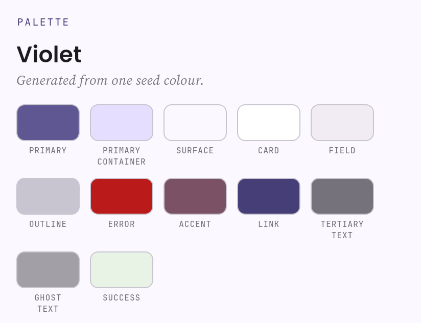
  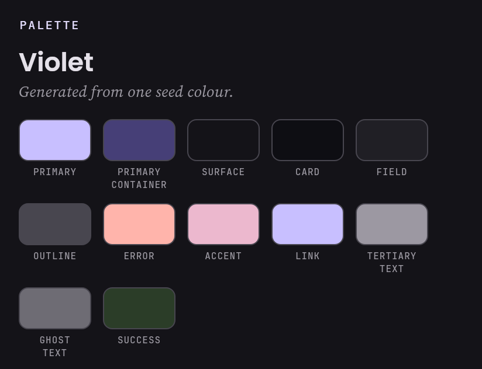
</p>

## Type

Three bundled families: Poppins for UI, Source Serif 4 for prose and asides,
JetBrains Mono for labels. The type scale is in the theme; `ForgeType` builds
one-off styles in each voice.

```dart
Text('Title large, 22', style: context.text.titleLarge);
Text('Prose reads in the serif.', style: context.text.bodyLarge);

Text(
  'A serif italic aside.',
  style: ForgeType.serif(size: 13.5, italic: true, color: context.forge.textTertiary),
);

const ForgeMonoLabel('Mono label'); // uppercases its text
const ForgeMonoLabel('Mono label, emphasis', emphasis: true);
```

<p>
  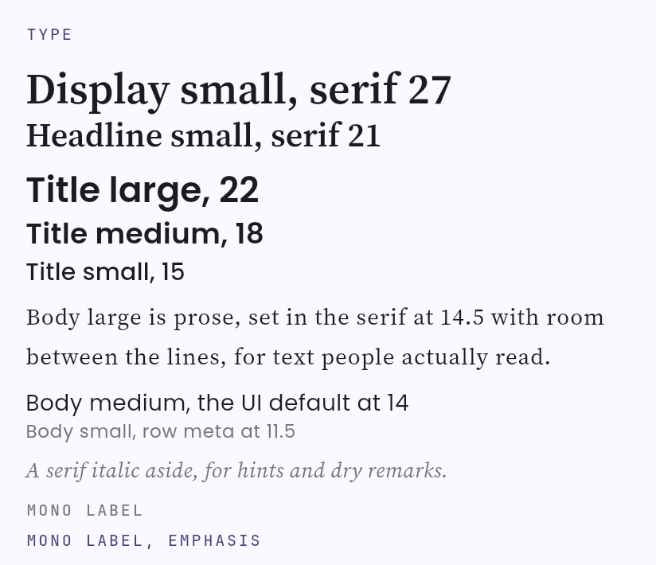
  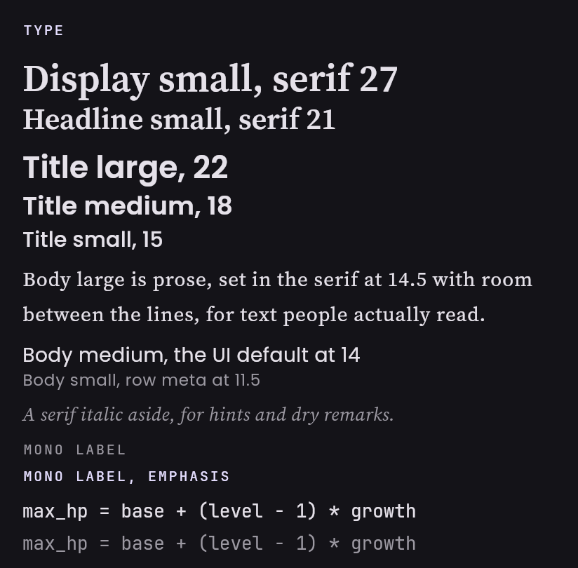
</p>

## Buttons

Plain Material buttons, styled by the theme: radius 8, filled at 50 high,
outlined at 48.

```dart
FilledButton(onPressed: save, child: const Text('Save changes'));

Row(
  children: [
    Expanded(child: OutlinedButton(onPressed: google, child: const Text('Google'))),
    const SizedBox(width: 12),
    Expanded(child: OutlinedButton(onPressed: apple, child: const Text('Apple'))),
  ],
);

TextButton(onPressed: forgot, child: const Text('Forgot password?'));
```

<p>
  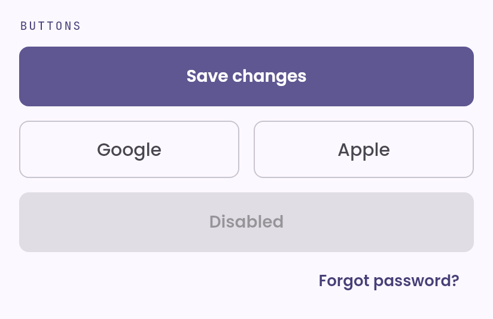
  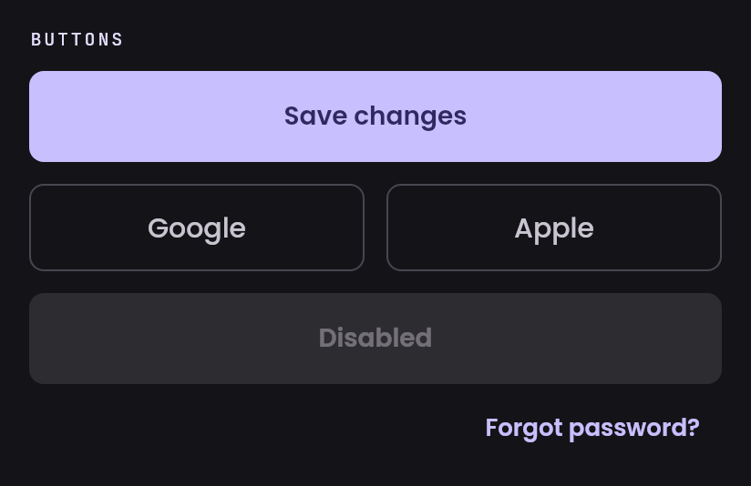
</p>

## Sign-in buttons

`ForgeSignInButton` draws "Continue with …" for a provider. Google's follows
Google's branding guidelines exactly (their colours from `ForgeProviderBrand`,
their official "G", Google Sans Medium, 40 high, pill): light or dark follows
the theme, or pass `theme: ForgeProviderButtonTheme.neutral`. The email
button is an ordinary outlined button. `busy` swaps the logo for a progress
ring and disables the button. Apple is reserved for the first iOS app.

```dart
ForgeSignInButton(provider: ForgeSignInProvider.google, onPressed: signInWithGoogle);
ForgeSignInButton(provider: ForgeSignInProvider.google, busy: true, onPressed: () {});
ForgeSignInButton(provider: ForgeSignInProvider.email, onPressed: showEmailForm);
```

<p>
  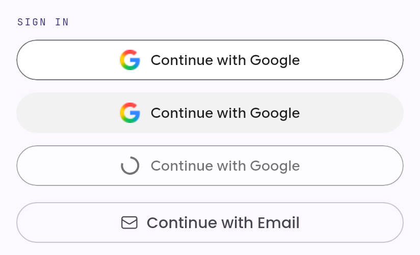
  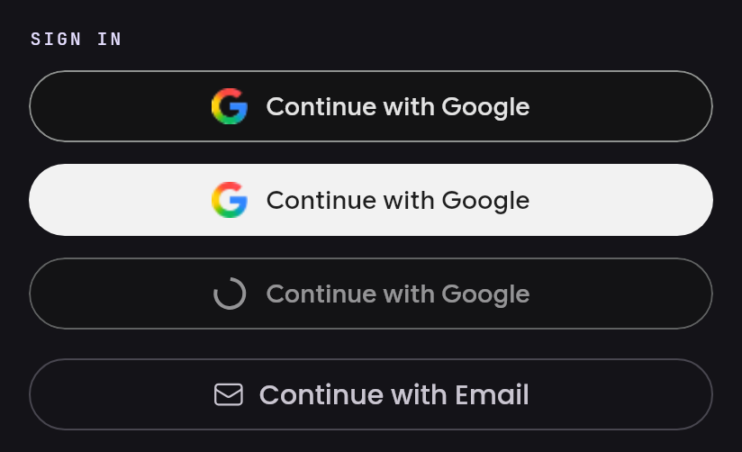
</p>

## Sign-in panel and screen

`ForgeSignInPanel` is the whole sign-in surface: the provider buttons above
an always-present email form that switches between **sign in**, **create an
account** and **forgot password**. Callbacks in, no auth logic: the app runs
the request and drives `busy` and `errorText` from the result. The panel
validates the address and (on create) an 8-character minimum itself, with
field-level errors on submit. A null `onGoogle` / `onApple` hides that
button; at least one is required. Embed it in your own screen, or use
`ForgeSignInScreen`, which adds the app bar and an optional "Not now".

```dart
ForgeSignInPanel(
  heading: 'Back up your notes',
  blurb: 'Sign in and they follow you to your next phone.',
  onGoogle: signInWithGoogle,
  onEmailSignIn: (email, password) => auth.signInWithEmail(email, password),
  onEmailCreate: (email, password) => auth.signUpWithEmail(email, password),
  onForgotPassword: auth.sendPasswordReset,
  busy: state.isBusy,
  errorText: state.error,
);
```

<p>
  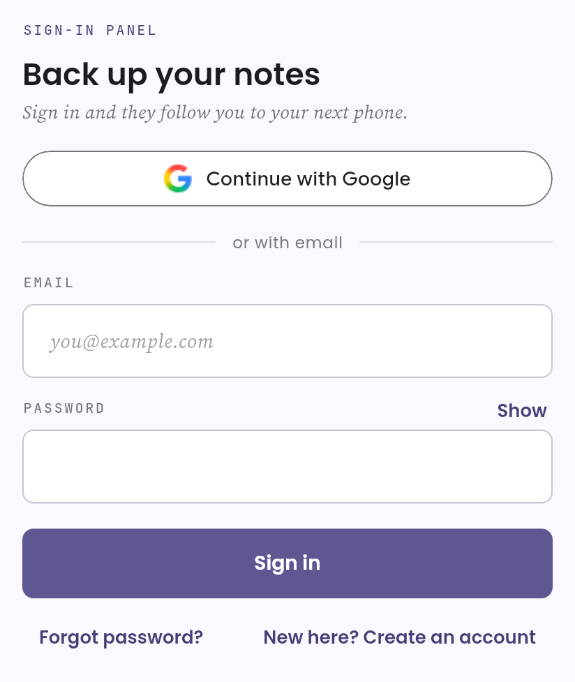
  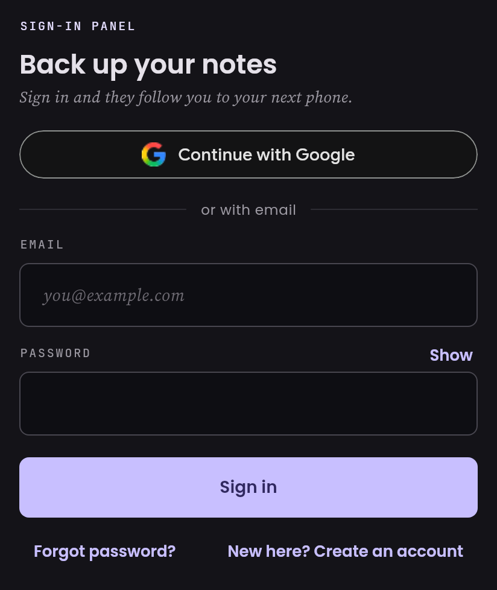
</p>
<p>
  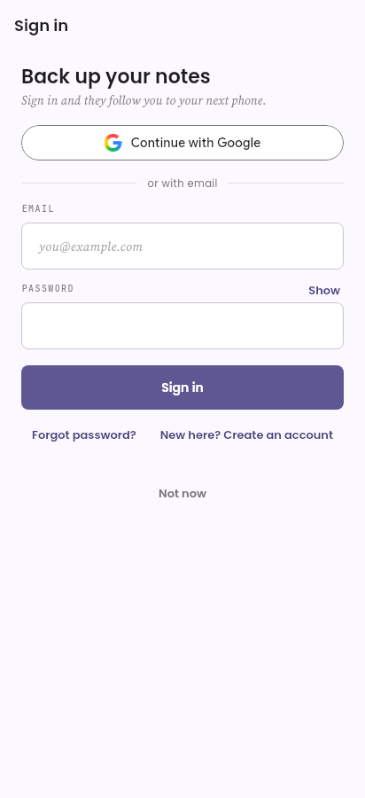
  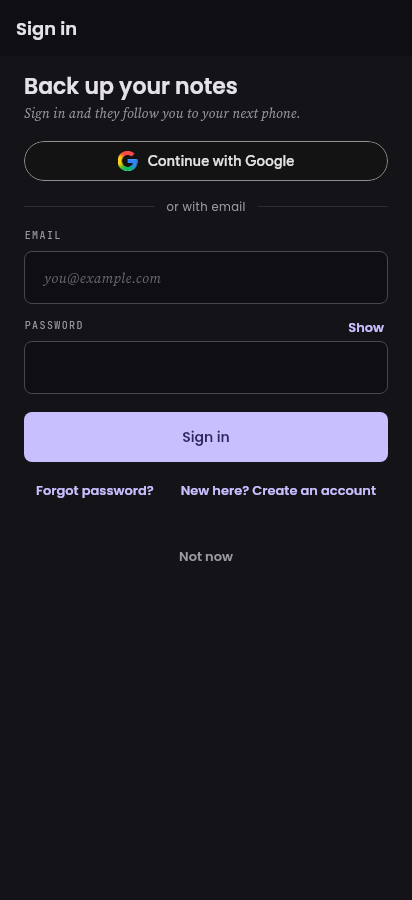
</p>

## Email screens

`ForgeCheckEmailScreen` is the waiting state after a sign-up
(`ForgeEmailPurpose.confirm`) or a reset request (`ForgeEmailPurpose.reset`):
the address the mail went to, "Send again" on a cooldown that starts the
moment the screen opens, "Use a different address" and Done.
`ForgeSetPasswordScreen` is the form the app shows when it opens from a
reset link (or for "Set a password" on a Google-only account): two fields
that must match and reach eight characters. Both take `busy` and
`errorText` from the app.

```dart
ForgeCheckEmailScreen(
  email: email,
  purpose: ForgeEmailPurpose.confirm,
  onResend: () => auth.resendConfirmation(email),
  onChangeEmail: () => context.pop(),
  onDone: () => context.go('/account'),
);

ForgeSetPasswordScreen(onSubmit: auth.updatePassword, busy: saving);
```

<p>
  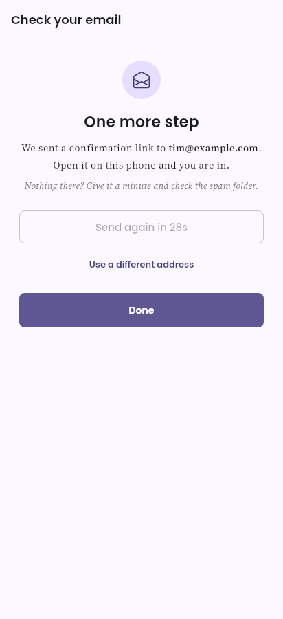
  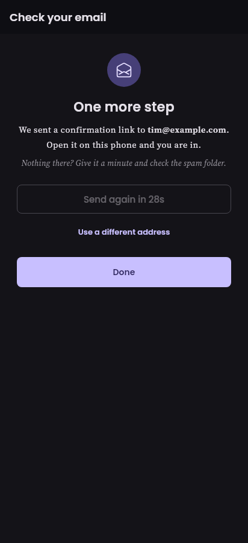
  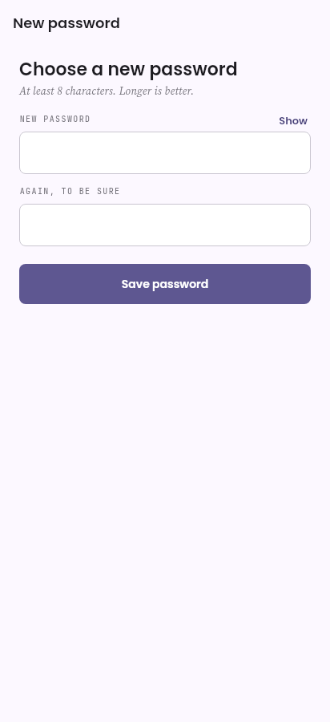
  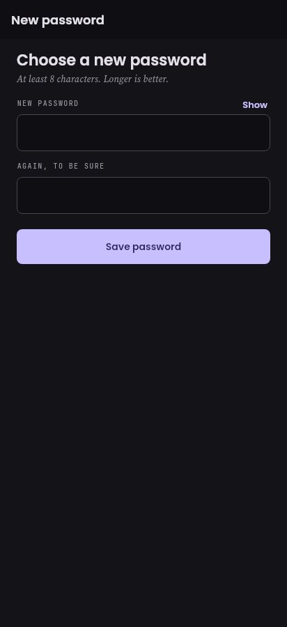
</p>

## Fields

`ForgeBoxedField` is the theme's outlined text field with its mono label
outside the box. A `SearchBar` picks up the pill shape from the theme.

```dart
ForgeBoxedField(
  label: 'Display name',
  hint: 'What to call you',
  controller: name,
);

ForgeBoxedField(
  label: 'Email',
  hint: 'you@example.com',
  keyboardType: TextInputType.emailAddress,
  errorText: 'That is not an email address.',
);

const SearchBar(hintText: 'Search');
```

<p>
  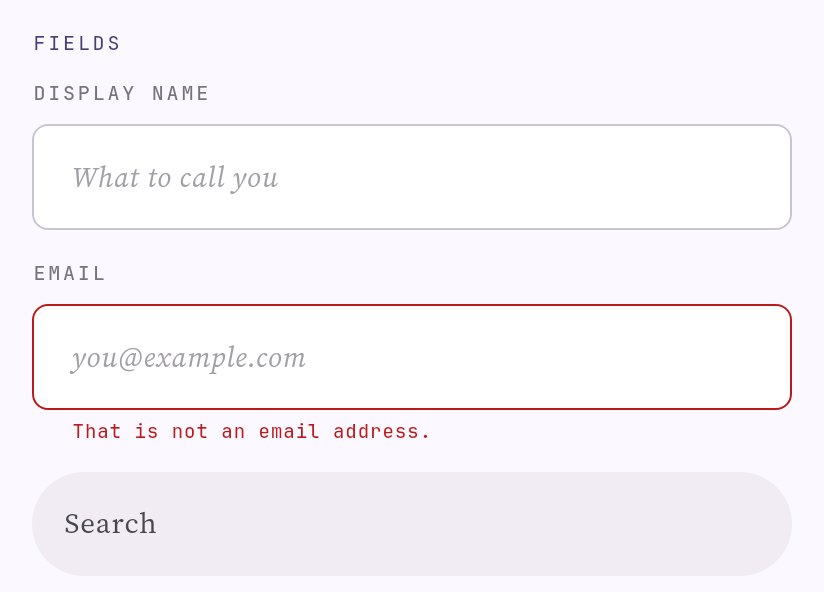
  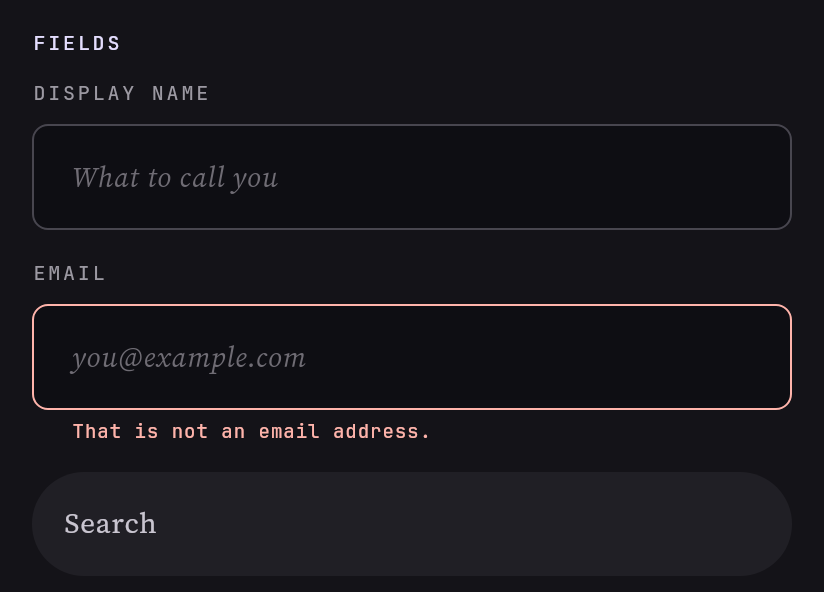
</p>

## Selection controls

Material's `FilterChip`, `SegmentedButton` and `Slider`, styled by the theme.
A `Switch` is styled the same way; see it in the settings group below.

```dart
FilterChip(
  label: const Text('Recent'),
  selected: recent,
  onSelected: (on) => setState(() => recent = on),
);

SegmentedButton<String>(
  showSelectedIcon: false,
  segments: const [
    ButtonSegment(value: 'List', label: Text('List')),
    ButtonSegment(value: 'Grid', label: Text('Grid')),
  ],
  selected: {view},
  onSelectionChanged: (s) => setState(() => view = s.first),
);

Slider(value: volume, onChanged: (v) => setState(() => volume = v));
```

<p>
  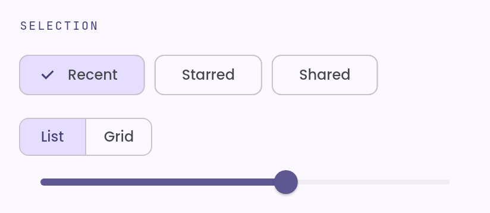
  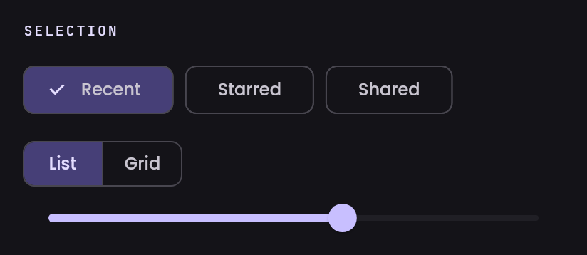
</p>

## Gradient FAB

`ForgeFab` is the one gradient button in an app, for its single main action.
It looks the same in every palette, because the forge gradient is the brand.

```dart
Scaffold(
  floatingActionButton: ForgeFab(
    label: 'New entry',
    onPressed: create,
  ),
);
```

<p>
  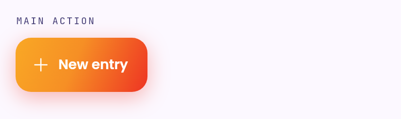
  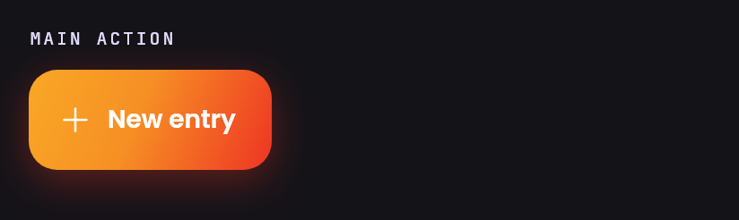
</p>

## Capsules

`ForgeTagCapsule` labels a thing; `ForgeStatusCapsule` reports a state. Both
uppercase their text.

```dart
const ForgeTagCapsule('Neutral');
const ForgeTagCapsule('Emphasis', tone: ForgeCapsuleTone.emphasis);

const ForgeStatusCapsule('Connected', active: true);
const ForgeStatusCapsule('Not connected');
```

<p>
  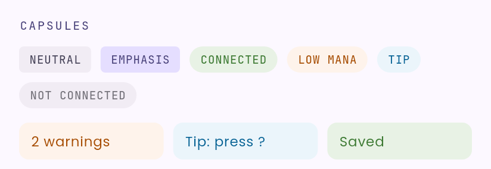
  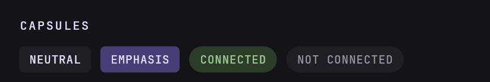
</p>

## Settings group

`ForgeSettingsGroup` is a mono label over a bordered card whose rows are
separated by dividers. The rows are ordinary `ListTile`s.

```dart
ForgeSettingsGroup(
  label: 'Account',
  children: [
    ListTile(
      title: const Text('Google'),
      subtitle: const Text('you@example.com'),
      trailing: const ForgeStatusCapsule('Connected', active: true),
    ),
    SwitchListTile(
      title: const Text('Notifications'),
      subtitle: const Text('Only the ones that matter'),
      value: notifications,
      onChanged: (v) => setState(() => notifications = v),
    ),
    ListTile(
      title: const Text('About'),
      trailing: HeroIcon(HeroIcons.chevronRight, size: 18, color: context.forge.textTertiary),
      onTap: openAbout,
    ),
  ],
);
```

<p>
  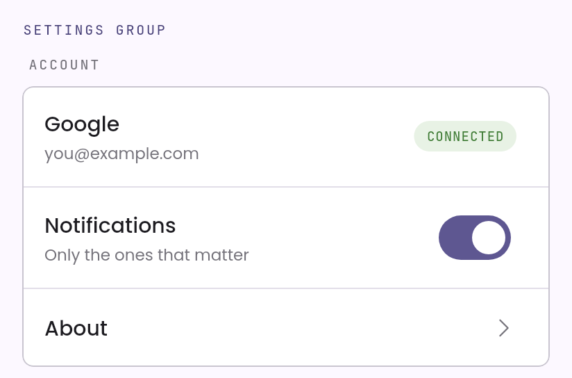
  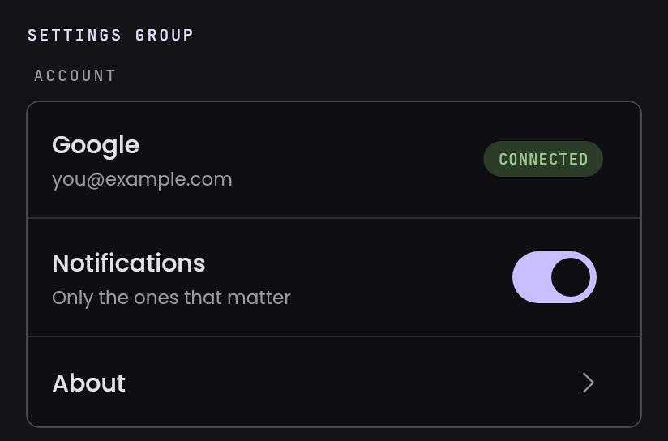
</p>

## Empty, error and loading states

```dart
ForgeEmptyState(
  icon: const HeroIcon(HeroIcons.documentText),
  title: 'Nothing here yet',
  aside: "It isn't going to write itself.",
  action: FilledButton(onPressed: start, child: const Text('Start one')),
);
```

<p>
  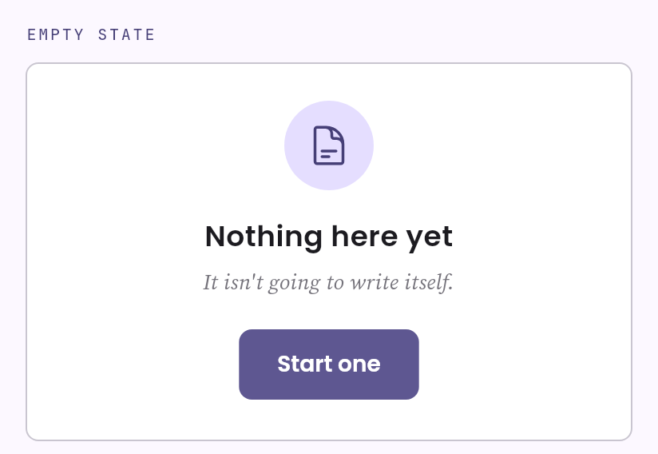
  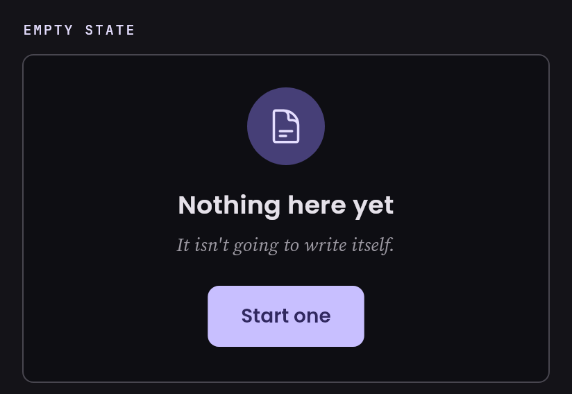
</p>

```dart
ForgeErrorCard(
  message: "Couldn't reach the server.",
  onRetry: reload, // null hides the button
);
```

<p>
  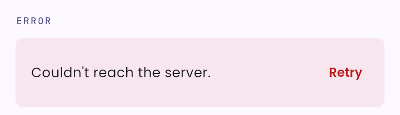
  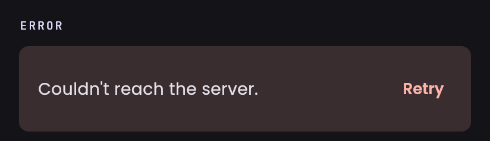
</p>

```dart
const ForgeSkeletonList(); // three shimmering rows; pass count for more
```

<p>
  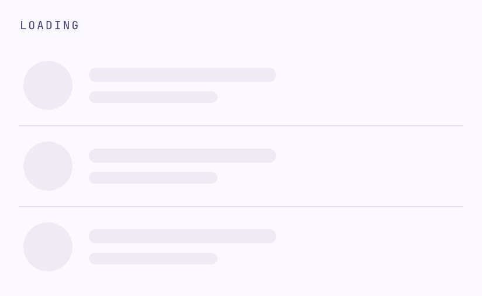
  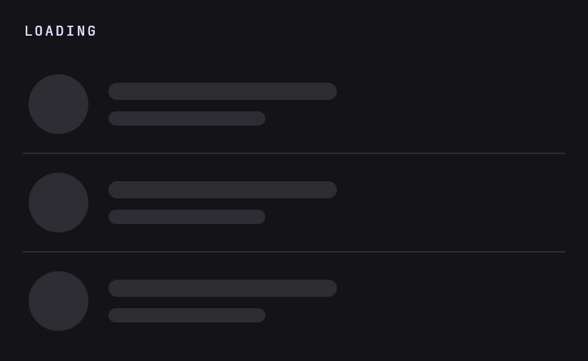
</p>

## Confirm sheet

A bottom sheet that resolves to `true` on confirm and `false` on cancel or
dismiss. It is destructive by default; pass `destructive: false` for a plain
confirmation.

```dart
final confirmed = await showForgeConfirmSheet(
  context,
  title: 'Delete your account?',
  aside: 'Everything goes with it. Just saying.',
  confirmLabel: 'Delete',
);
if (confirmed) deleteAccount();
```

<p>
  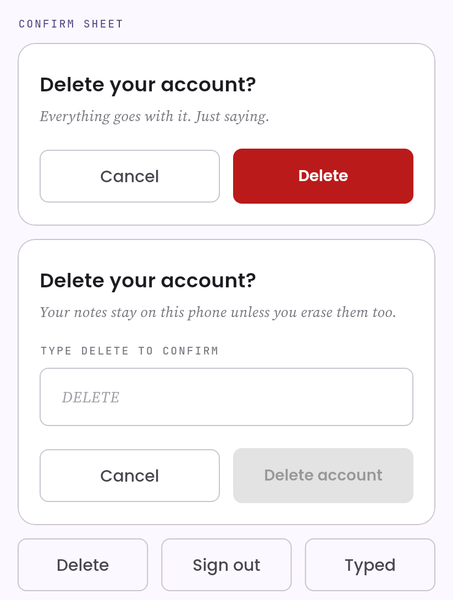
  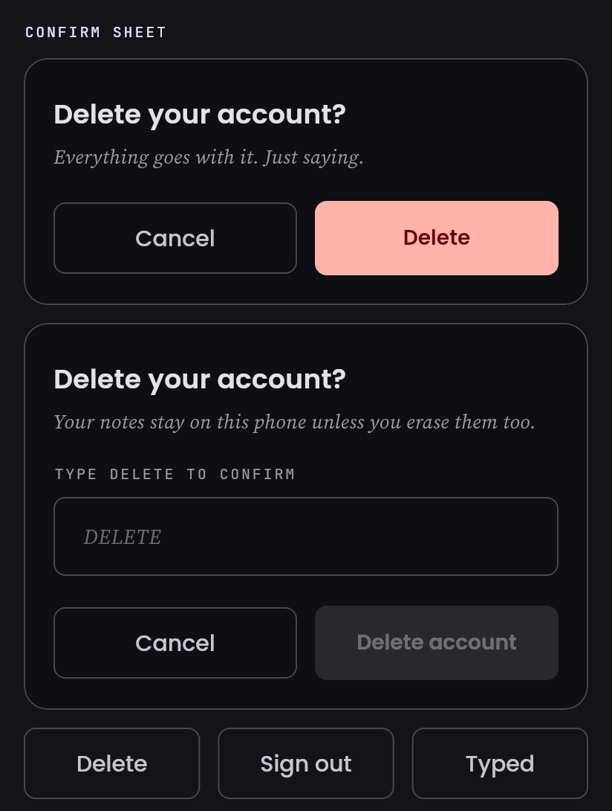
</p>

The top card is the sheet's content; the buttons under it open the real
sheet in the running app.

The typed variant guards the irreversible: `typeToConfirm` keeps the
destructive button disabled until the user types the word (case-insensitive
unless `caseSensitive: true`), and `onConfirmAsync` runs the action inside
the sheet, showing progress and refusing dismissal while it runs. Return
`null` to close with `true`; return a message to keep the sheet open with
that message under the field.

```dart
final deleted = await showForgeConfirmSheet(
  context,
  title: 'Delete your account?',
  aside: 'Your notes stay on this phone unless you erase them too.',
  confirmLabel: 'Delete account',
  typeToConfirm: 'DELETE',
  onConfirmAsync: () async {
    final result = await core.accounts.deleteAccount();
    return result is ForgeAuthFailure ? "Couldn't reach the server." : null;
  },
);
```

## Brand marks

The TK ForgeWorks mark in its brand colors, the same mark in one tint, a
forge-gradient badge of the kind an app puts its own glyph on, and the forge
strip. These colors come from `ForgeBrand` and do not change with the theme.

```dart
const ForgeWorksMark(size: 48);
ForgeWorksMark(size: 48, color: context.forge.textTertiary);

const DecoratedBox(
  decoration: BoxDecoration(gradient: ForgeBrand.forgeStrip),
);
```

<p>
  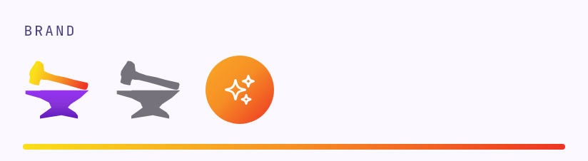
  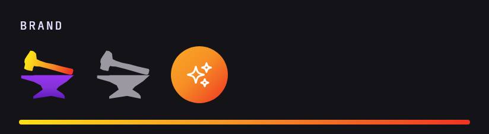
</p>

## About and licences screens

Both are full screens. Every link is a callback the app wires to its own URL
launcher or router, and a null callback leaves that row out.

```dart
ForgeAboutScreen(
  appName: 'Showcase',
  version: '0.1.0',
  badge: const AppBadge(size: 64),
  blurb: 'One paragraph in the app\'s voice.',
  footnote: 'Nothing here leaves this device.',
  onSendFeedback: openFeedbackScreen,     // the app's own screen
  onOpenWebsite: openSite,
  onOpenPrivacyPolicy: openPrivacyPolicy, // required
  onOpenDeleteAccount: openDeletionPage,  // null in an app with no accounts
  onOpenLicenses: () => Navigator.of(context).push(
    MaterialPageRoute<void>(builder: (_) => licenses),
  ),
);

ForgeLicensesScreen(
  appName: 'Showcase',
  licenseName: 'Apache License 2.0',
  sourceLabel: 'github.com/tkforgeworks/forge-ui',
  onOpenSource: openRepository,
  footnote: 'The TK ForgeWorks mark is all rights reserved.',
);
```

<p>
  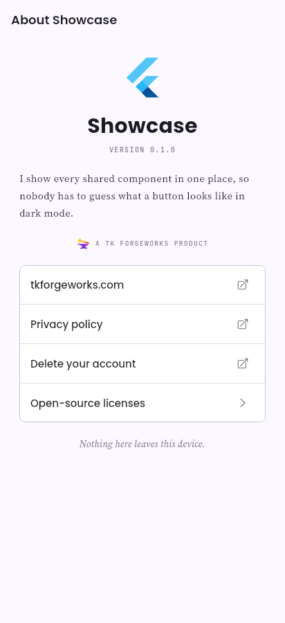
  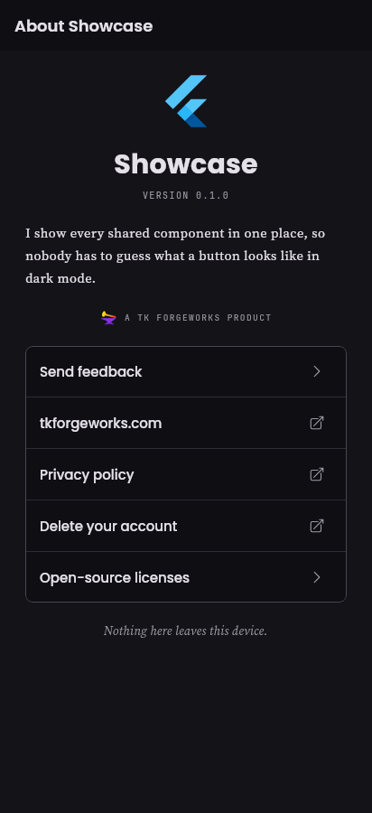
  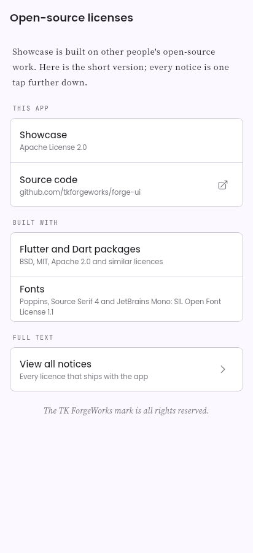
  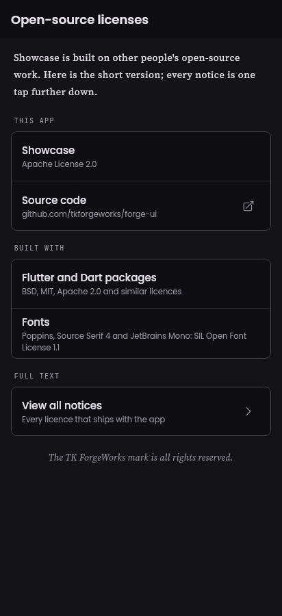
</p>

## Other palettes

The same components under the other three samples. Teal and Ember are seeds
(Teal also passes an `accent`). Cream & amber is a designed palette: the app
passes its own `colorScheme` and `tokens` to `forgeTheme`, and the brand's
type, shapes and component themes apply on top.

### Teal

<p>
  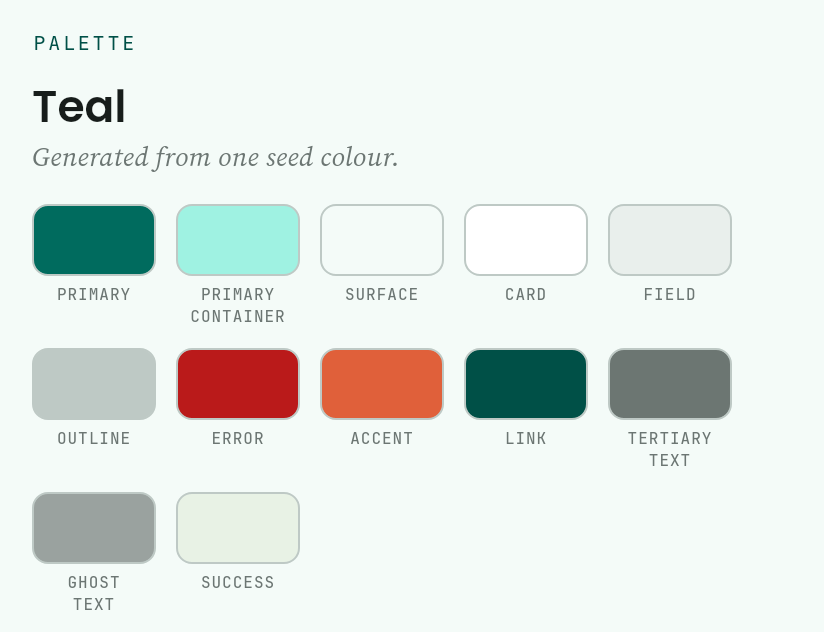
  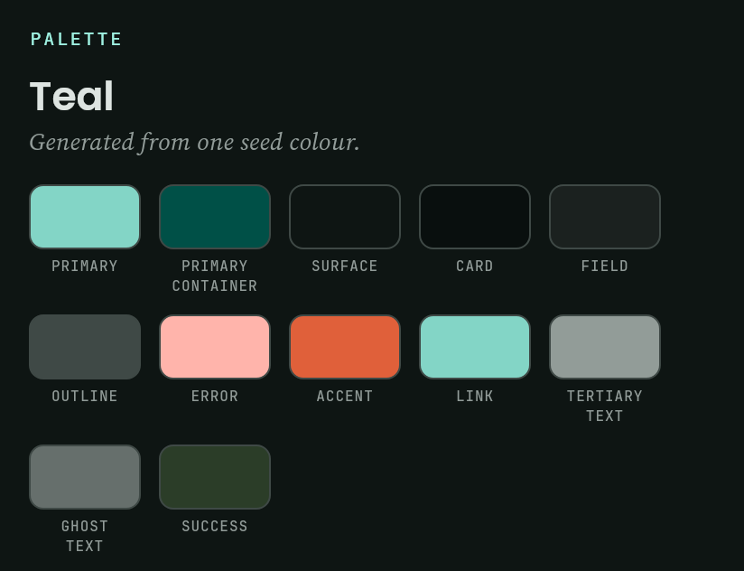
</p>
<p>
  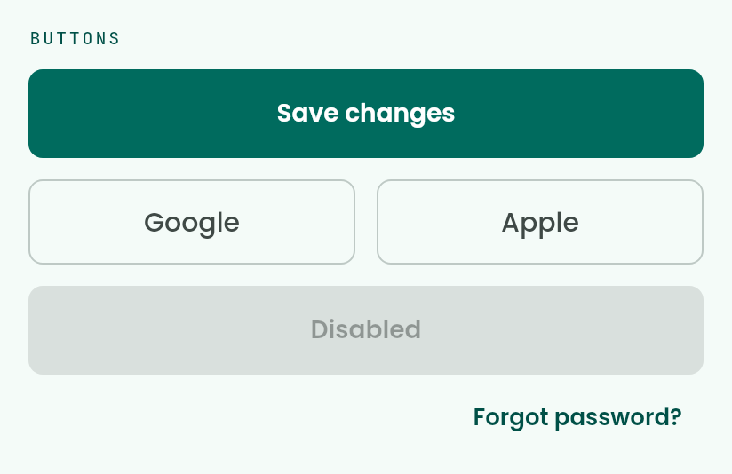
  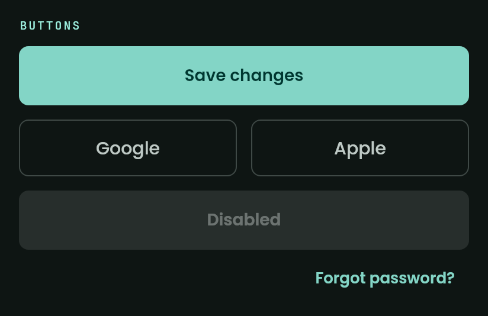
</p>

### Ember

<p>
  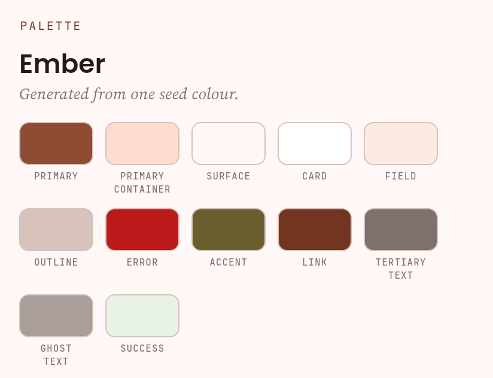
  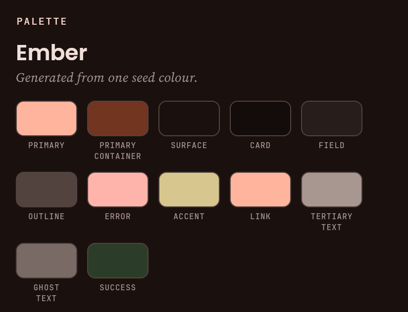
</p>
<p>
  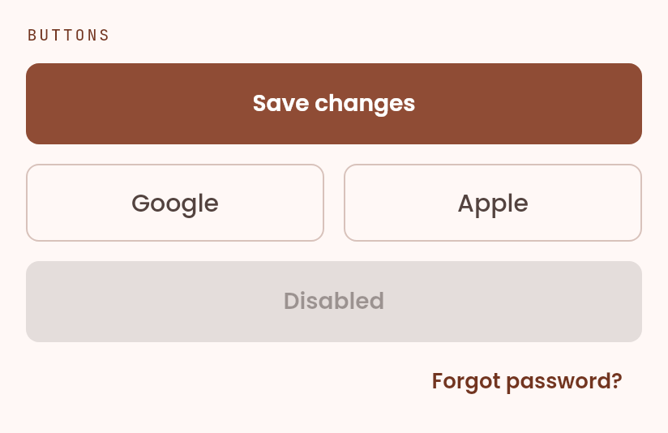
  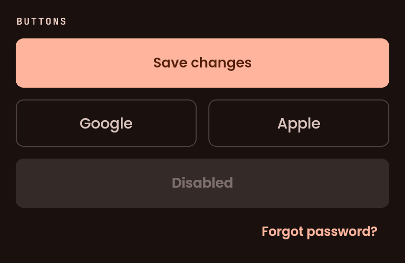
</p>

### Cream & amber (designed)

<p>
  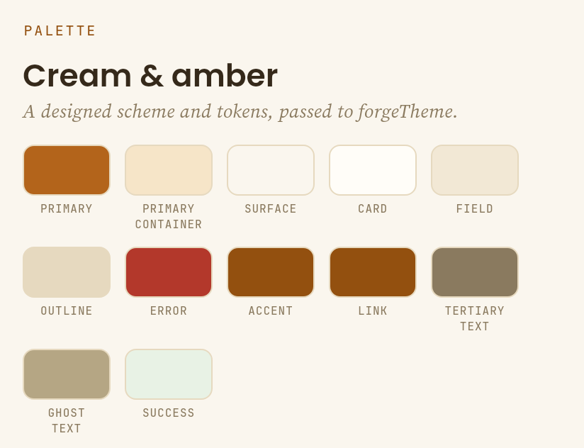
  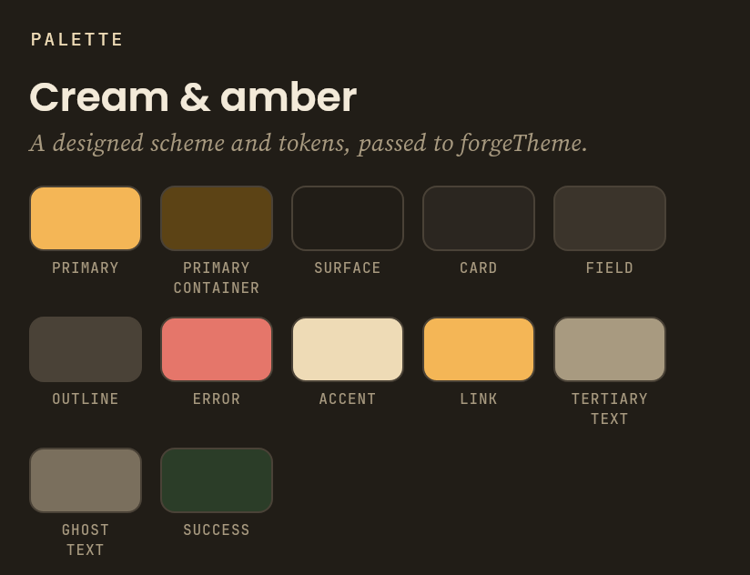
</p>
<p>
  
  
</p>

<details>
<summary>The whole gallery in each palette</summary>

Light:

<p>
  
  
  
  
</p>

Dark:

<p>
  
  
  
  
</p>

</details>

## Running it

```sh
flutter run -d linux      # or an Android device
```

Open the drawer to switch palette; the sun/moon button switches brightness.

## Golden tests

Every picture above is a golden image under `test/goldens/`: the whole
gallery for each palette and brightness, each gallery section on its own
(`components/` and `palettes/`, rendered at 2x), and the about and licences
screens. CI compares them on every push as the `showcase / ci` job.

```sh
flutter test                      # compare against the committed images
flutter test --update-goldens     # after an intended visual change
```

Look at the regenerated images before committing them: they are the review
of the change, and they are what this page shows. A new gallery section goes
in `gallerySections` in `lib/gallery.dart` and gets a heading here.
